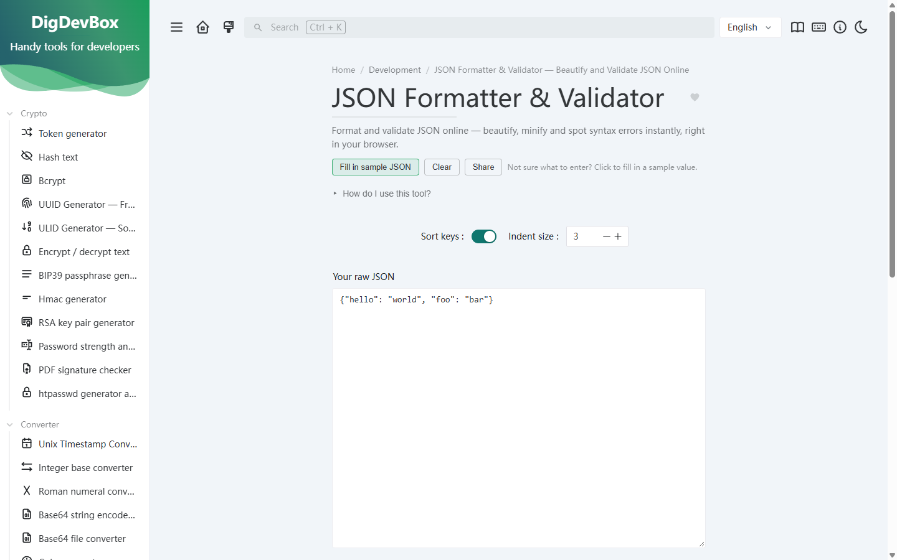

# DigDevBox — Developer Tools

**DigDevBox** is a collection of 104 free online tools for developers and DevOps — JSON, JWT, regex, UUID, network and more. Tools run locally in your browser by default; a few require a network query.

| | |
| --- | --- |
| **Website** | <https://digdevbox.com> |
| **Blog** | <https://notes.digdevbox.com> |
| **Source code** | <https://github.com/yqh-core/dev-tools> |

<p>
  
</p>

## Screenshots

| | | |
| :---: | :---: | :---: |
|  |  |  |
| JWT Decoder & Parser | JSON Formatter & Validator | Regex Tester |

## Why DigDevBox

- **104 utilities across 10 categories** — see the full list below
- **No signup, no installation** — open a page and use the tool
- **Local-first** — most tools process data entirely in your browser; nothing is uploaded (a few tools, e.g. WHOIS lookup and HTTP status checker, query a backend API and are labeled as such)
- **Open source** — GPLv3, self-hostable as a static site

## All tools (104)

<!-- generated-tools-list:start -->
### Crypto

- [Token Generator](https://digdevbox.com/token-generator) - A random string, 1 to 512 characters, from the sets you tick. Useful for tokens and fixtures. It is generated in this browser.
- [Hash Generator — MD5, SHA-1, SHA-256 Online](https://digdevbox.com/hash-text) - Hash a text string using the function you need : MD5, SHA1, SHA256, SHA224, SHA512, SHA384, SHA3 or RIPEMD160 — with 16-digit MD5 and upper/lower-case hex output
- [Bcrypt](https://digdevbox.com/bcrypt) - Hash a password with bcrypt, or check a hash you already have. The work happens in this browser, so don't paste a production secret you wouldn't type into a local terminal.
- [UUID Generator — v4, v1, v3, v5 and NIL IDs](https://digdevbox.com/uuid-generator) - Generate UUIDs online for free — v4 random, v1 time-based, v3/v5 namespace UUIDs and NIL, with one-click copy.
- [ULID Generator — Time-Ordered, Sortable IDs Online](https://digdevbox.com/ulid-generator) - Generate ULIDs online — sortable, time-ordered unique identifiers, ideal for database keys and distributed systems.
- [Nano ID Generator — Short, URL-safe Unique IDs Online](https://digdevbox.com/nanoid-generator) - Generate nanoid-style unique IDs online — URL-safe alphabet, any length, batch of up to 200, built with crypto randomness in your browser.
- [Encrypt / decrypt text](https://digdevbox.com/encryption) - Encrypt clear text and decrypt ciphertext using crypto algorithms like AES, TripleDES, Rabbit or RC4.
- [BIP39 passphrase generator](https://digdevbox.com/bip39-generator) - Generate a BIP39 passphrase from an existing or random mnemonic, or get the mnemonic from the passphrase.
- [HMAC Generator — Sign Messages with SHA-256 Online](https://digdevbox.com/hmac-generator) - Generate HMAC signatures online with SHA-256/SHA-512 and a secret key — debug webhook signature mismatches, output hex or Base64. Keys stay in your browser.
- [RSA Key Pair Generator](https://digdevbox.com/rsa-key-pair-generator) - Generate an RSA private/public key pair online — PEM format, 2048 to 8192 bits, for SSH, TLS or JWT RS256. No OpenSSL install, keys never leave your browser.
- [Password strength analyser](https://digdevbox.com/password-strength-analyser) - See which rules a password fails, and a rough guess of how long it might take to crack. The check stays in this browser.
- [Password Generator](https://digdevbox.com/password-generator) - Pick a length and the characters you want. Ambiguous letters (Il1O0) are left out unless you ask for them. Generated here, not on a server.
- [PDF signature checker](https://digdevbox.com/pdf-signature-checker) - Verify the signatures of a PDF file. A signed PDF file contains one or more signatures that may be used to determine whether the contents of the file have been altered since the file was signed.
- [PDF Merge](https://digdevbox.com/pdf-merge) - Combine multiple PDF files into one — in upload order, page count shown before you start. Free, private, everything happens in your browser.
- [PDF Split](https://digdevbox.com/pdf-split) - Split a PDF into single pages, or extract a page range — page count is read from the file before you choose. Free, private, runs in your browser.
- [PDF Watermark](https://digdevbox.com/pdf-watermark) - Add a text watermark to every page of a PDF — adjustable size, opacity, angle, single line or tiled. Free, private, runs in your browser.
- [PDF Compressor](https://digdevbox.com/pdf-compress) - Compress PDF files online by recompressing embedded photos and rebuilding the file structure. Two levels, live before/after sizes, never larger than the original. Free, private, runs in your browser.
- [htpasswd generator and checker](https://digdevbox.com/htpasswd-generator) - Generate .htpasswd lines for Apache or Nginx basic auth using bcrypt, apr1, SHA1 or plain text, and verify existing entries.

### Converter

- [Date Converter — Formats, Time Zones and ISO 8601](https://digdevbox.com/date-converter) - Move a date between ISO 8601, RFC 3339, Excel, a Mongo ObjectId, and a Unix timestamp. Time zones are labeled, not guessed in silence.
- [Unix Timestamp Converter — Epoch to Date, Seconds vs Milliseconds](https://digdevbox.com/unix-timestamp-converter) - Seconds or milliseconds, to a date and back. The page tells you which unit it assumed.
- [Integer base converter](https://digdevbox.com/base-converter) - Convert a number between different bases (decimal, hexadecimal, binary, octal, base64, ...)
- [Base64 Encoder & Decoder — Padding, URL-Safe, Binary-Safe](https://digdevbox.com/base64-string-converter) - Encode or decode Base64, including URL-safe base64url and padding. Text stays in this browser. For a real file, use Base64 to image.
- [Base64 to Image — Online Decode, Preview and Download](https://digdevbox.com/base64-file-converter) - Convert a string, file, or image into its base64 representation.
- [Color converter](https://digdevbox.com/color-converter) - Move a color between hex, RGB, HSL, HWB, LCH, CMYK, and a CSS name. The swatch updates as you type.
- [Color Contrast Checker — Pass or Fail WCAG AA and AAA](https://digdevbox.com/color-contrast-checker) - Check two colors against WCAG AA and AAA, for normal text and large text, with a preview of the pair.
- [Case converter](https://digdevbox.com/case-converter) - Transform the case of a string and choose between different formats
- [Text to ASCII binary](https://digdevbox.com/text-to-binary) - Convert text to its ASCII binary representation and vice-versa.
- [Text to Unicode](https://digdevbox.com/text-to-unicode) - Parse and convert text to unicode and vice-versa — HTML entities or plain decimal code points.
- [YAML to JSON converter](https://digdevbox.com/yaml-to-json-converter) - Paste YAML, get JSON. A bad indent is reported with a line and column.
- [YAML to TOML](https://digdevbox.com/yaml-to-toml) - Parse and convert YAML to TOML.
- [JSON to YAML converter](https://digdevbox.com/json-to-yaml-converter) - Paste JSON, get YAML. If the JSON is broken, the error stays on the page instead of a blank result.
- [JSON to TOML](https://digdevbox.com/json-to-toml) - Parse and convert JSON to TOML.
- [List converter](https://digdevbox.com/list-converter) - Remove duplicates, sort, reverse, lowercase, trim and add prefix/suffix to a list, one item per line. Everything runs in your browser — no upload.
- [TOML to JSON](https://digdevbox.com/toml-to-json) - Parse and convert TOML to JSON.
- [TOML to YAML](https://digdevbox.com/toml-to-yaml) - Parse and convert TOML to YAML.
- [XML to JSON](https://digdevbox.com/xml-to-json) - Paste XML, get JSON. Handy when a legacy API still speaks XML.
- [JSON to XML](https://digdevbox.com/json-to-xml) - Paste JSON, get XML. Broken JSON is reported instead of a half-written document.
- [Markdown to HTML](https://digdevbox.com/markdown-to-html) - Convert Markdown to HTML, with print support (save as PDF).
- [RMB amount in Chinese uppercase](https://digdevbox.com/rmb-uppercase) - Turn a numeric amount into the Chinese financial uppercase wording (yuan / jiao / fen), with an optional RMB prefix.
- [ASCII table](https://digdevbox.com/ascii-table) - The standard ASCII table from 0 to 127 with decimal, hexadecimal, octal and binary values, searchable by character or code.

### Web

- [URL Encoder & Decoder — Percent-Encoding, encodeURIComponent Pitfalls](https://digdevbox.com/url-encoder) - Percent-encode text, or decode it back. Use it when a query string ate a space, a plus, or a non-ASCII character.
- [Escape HTML entities](https://digdevbox.com/html-entities) - Escape or unescape HTML entities (turn <, >, &, " and ' into their HTML form) and look up common characters — quotes, dashes, currency, math and Greek symbols — in a searchable entity reference table.
- [URL parser](https://digdevbox.com/url-parser) - Split a URL into protocol, host, port, path, and query. Useful when a redirect or a log line is hard to read.
- [Device information](https://digdevbox.com/device-information) - Get information about your current device (screen size, pixel-ratio, user agent, ...)
- [Basic auth generator](https://digdevbox.com/basic-auth-generator) - Generate a base64 basic auth header from a username and password.
- [Open graph meta generator](https://digdevbox.com/og-meta-generator) - Generate open-graph and socials HTML meta tags for your website.
- [OTP code generator](https://digdevbox.com/otp-generator) - Generate and validate time-based OTP (one time password) for multi-factor authentication.
- [MIME types](https://digdevbox.com/mime-types) - Convert MIME types to file extensions and vice-versa.
- [JWT Decoder & Parser — Inspect Header, Payload and Expiration](https://digdevbox.com/jwt-parser) - Read the header, payload, and expiry of a JWT. The token stays in this browser. This does not verify the signature.
- [Slugify string](https://digdevbox.com/slugify-string) - Make a string url, filename and id safe.
- [User-agent parser](https://digdevbox.com/user-agent-parser) - Detect and parse Browser, Engine, OS, CPU, and Device type/model from an user-agent string.
- [HTTP status codes](https://digdevbox.com/http-status-codes) - The list of all HTTP status codes, their name, and their meaning.
- [JSON diff](https://digdevbox.com/json-diff) - Paste two JSON values and read the difference. Useful when an API response drifted and a diff tool would be overkill.
- [Outlook SafeLink Decoder](https://digdevbox.com/safelink-decoder) - Decode SafeLink URLs from Outlook emails and recover the real address.
- [JSON to GET params](https://digdevbox.com/json-to-get-params) - Flatten JSON into a URL query string (a[b][0]=1 style) and rebuild JSON from a query string or a full URL.
- [HTTP headers & request methods](https://digdevbox.com/http-headers) - A searchable reference of common HTTP request and response headers plus the nine standard request methods, covering CORS, caching, security fields and safe/idempotent semantics.

### Images and videos

- [QR Code generator](https://digdevbox.com/qrcode-generator) - Generate and download a QR code for a URL (or just plain text), and customize the background and foreground colors.
- [WiFi QR Code generator](https://digdevbox.com/wifi-qrcode-generator) - Generate and download QR codes for quick connections to WiFi networks.
- [Image Resizer](https://digdevbox.com/image-resize) - Resize images online to exact pixel dimensions — step-down scaling keeps detail instead of smearing it, and nothing is uploaded because it all runs in your browser.
- [Image Compressor](https://digdevbox.com/image-compress) - Compress JPEG and WebP images online to a quality level or a target file size — lossy re-encoding in your browser, so the file never leaves your machine.
- [Image Cropper](https://digdevbox.com/image-crop) - Crop an image to an exact pixel region in your browser — drag the box, lock a ratio, and export at the true source resolution, not a scaled-down copy.
- [Image Color Picker](https://digdevbox.com/image-color-picker) - Click any pixel of an image to read its exact colour as HEX, RGB and HSL — sampled from the original file, entirely offline in your browser.
- [Favicon Generator](https://digdevbox.com/favicon-generator) - Turn any image into a real multi-size favicon.ico plus apple-touch-icon and 512px PNG — centre-cropped and resized in your browser, nothing uploaded.
- [Images to PDF](https://digdevbox.com/image-to-pdf) - Combine images into one PDF, each on its own page at its own size — JPEG is carried in without re-compression, and everything runs in your browser.

### Development

- [Git cheatsheet](https://digdevbox.com/git-memo) - Git is a decentralized version management software. With this cheatsheet, you will have quick access to the most common git commands.
- [Crontab Generator — Cron Expressions with Plain-English Preview](https://digdevbox.com/crontab-generator) - Build cron expressions with a plain-English preview — every 5 minutes, weekdays, @reboot. Validate crontab and GitHub Actions schedules free in your browser.
- [JSON Formatter & Validator — Beautify, Validate, Diff and Convert](https://digdevbox.com/json-prettify) - Pretty-print, minify, or open a tree. Invalid JSON points at the broken character. You can also upload a file or drop one on the page.
- [JSON Developer Workspace — Format, Query, Tree, Schema & Convert](https://digdevbox.com/json-workspace) - A professional JSON workspace — format and validate, explore an interactive tree, query with JSONPath, infer JSON Schema, and convert to YAML or CSV, all in your browser.
- [API Debug Workspace — cURL, Test Assertions & Response Pipeline](https://digdevbox.com/api-debugger) - Import a cURL command, send the request through a transient edge relay, assert status codes, JSON fields, headers and response time with a built-in test runner, run your whole saved collection as a regression suite, organize variables into Global / Collection / Environment scopes with secret masking, then inspect the response or hand it to the JSON workspace — all in your browser.
- [JSON minify](https://digdevbox.com/json-minify) - Minify and compress your JSON by removing unnecessary whitespace.
- [JSON to CSV](https://digdevbox.com/json-to-csv) - Paste a JSON array of objects and get CSV, with headers taken from the keys.
- [CSV to JSON](https://digdevbox.com/csv-to-json) - Paste CSV, get a JSON array. Quoted fields and line breaks inside cells are kept. Duplicate column names are called out.
- [SQL Formatter — Format and Beautify SQL Online](https://digdevbox.com/sql-prettify) - Paste a messy query. Get it indented, or squeezed to one line. PostgreSQL, MySQL, T-SQL, BigQuery, and other dialects. A syntax error is shown instead of a blank box.
- [Chmod Calculator — Unix File Permissions (755, 644, 777)](https://digdevbox.com/chmod-calculator) - Compute your chmod permissions and commands with this online chmod calculator.
- [Docker Run to Compose Converter — Generate a compose Service from a Command](https://digdevbox.com/docker-run-to-docker-compose-converter) - Paste a docker run command and get a docker-compose service — ports, volumes and env mapped. Free online decomposerize alternative, in your browser.
- [XML Formatter — Beautify, Validate and Minify XML](https://digdevbox.com/xml-formatter) - Prettify or minify your XML string — human-readable indentation, or strip it back down to a single line.
- [YAML Formatter & Validator — Format YAML Online](https://digdevbox.com/yaml-prettify) - Fix YAML indentation before kubectl or CI rejects it. Tabs and syntax errors are reported with a line and column.
- [Regex Tester — JavaScript Regex Tester Online](https://digdevbox.com/regex-tester) - Test regular expressions online with live match results — JavaScript flavor, toggle flags and capture groups instantly.
- [Regex Cheat Sheet — Complete Regular Expression Reference](https://digdevbox.com/regex-memo) - A complete regex cheat sheet — common regular expression syntax, quantifiers, flags and character classes with examples.
- [px / rem converter](https://digdevbox.com/px-rem-converter) - Convert a batch of values between px and rem with a configurable root font size.
- [JSON to model classes](https://digdevbox.com/json-to-code) - Generate TypeScript, C#, Java or Go model classes from JSON, splitting nested objects into their own classes.
- [Linux commands cheat sheet](https://digdevbox.com/linux-commands) - A searchable cheat sheet of common Linux commands with what they do and ready-to-use examples.
- [Prepare Deployment — Pre-Deploy Readiness Gate for Docker, CI & Lockfiles](https://digdevbox.com/prepare-deployment) - Pre-deployment readiness gate for your project. Paste package.json, lockfile, Dockerfile and CI workflow, or import Trivy/Checkov/Hadolint/SARIF JSON or actionlint text; get a READY / READY_WITH_WARNINGS / BLOCKED / NOT_ASSESSED verdict with evidence-backed findings (reproducible builds, pinned images, non-root containers, CI injection risks, hardcoded secrets, real scanner results) and an exportable release report. Inspired by Vercel/Netlify preflight checks; runs fully in your browser.

### Network

- [IPv4 Subnet Calculator](https://digdevbox.com/ipv4-subnet-calculator) - Paste a CIDR like 192.168.1.0/24 and get the full subnet breakdown — usable hosts, first/last address, netmask, wildcard. Built for VPC and VLAN planning, free in your browser.
- [IPv4 address converter](https://digdevbox.com/ipv4-address-converter) - Convert an IP address into decimal, binary, hexadecimal, or even an IPv6 representation of it.
- [IPv4 range expander](https://digdevbox.com/ipv4-range-expander) - Given a start and an end IPv4 address, this tool calculates a valid IPv4 subnet along with its CIDR notation.
- [MAC address lookup](https://digdevbox.com/mac-address-lookup) - Find the vendor and manufacturer of a device by its MAC address.
- [MAC address generator](https://digdevbox.com/mac-address-generator) - Enter the quantity and prefix. MAC addresses will be generated in your chosen case (uppercase or lowercase)
- [WHOIS lookup](https://digdevbox.com/whois-lookup) - Look up domain registration data such as registrar, dates and status. Powered by RDAP, the official successor of WHOIS.
- [HTTP status checker](https://digdevbox.com/http-status-checker) - Check the live HTTP status code and response headers of a URL to troubleshoot reachability, redirects and caching.

### Math

- [Math evaluator](https://digdevbox.com/math-evaluator) - A calculator for evaluating mathematical expressions. You can use functions like sqrt, cos, sin, abs, etc.
- [ETA Calculator](https://digdevbox.com/eta-calculator) - What does ETA mean? Estimated Time of Arrival — this calculator projects when your download, build or batch job will finish from current progress, with duration and clock time. Free, runs in your browser.
- [Percentage Calculator](https://digdevbox.com/percentage-calculator) - What is X% of Y? Find a percentage of a number, work out what percent one value is of another, or compute percentage increase and decrease — with the formula shown for each result.

### Measurement

- [Temperature converter](https://digdevbox.com/temperature-converter) - Degrees temperature conversions for Kelvin, Celsius, Fahrenheit, Rankine, Delisle, Newton, Réaumur, and Rømer.
- [Unit converter](https://digdevbox.com/unit-converter) - Convert between 11 categories of units: length, area, volume, weight, speed, time, data storage, power, pressure, angle and temperature.

### Text

- [Lorem Ipsum Generator](https://digdevbox.com/lorem-ipsum-generator) - Generate lorem ipsum placeholder text — paragraphs, sentences or words — for layouts and mockups. The classic printing-industry dummy text since the 1500s, free and instant, right in your browser.
- [Text statistics](https://digdevbox.com/text-statistics) - Get information about a text, the number of characters, the number of words, its size in bytes, ...
- [Emoji picker](https://digdevbox.com/emoji-picker) - Copy and paste emojis easily and get the unicode and code points value of each emoji.
- [Text diff](https://digdevbox.com/text-diff) - Paste two texts and read the line changes. Handy for configs, logs, and drafts.
- [ASCII Art Generator](https://digdevbox.com/ascii-text-drawer) - Turn text into ASCII art with multiple fonts and styles.
- [Full-width / half-width converter](https://digdevbox.com/fullwidth-converter) - Convert between full-width and half-width characters using the fixed Unicode offset 0xFEE0, or adjust punctuation only.
- [Batch text replacer](https://digdevbox.com/text-replacer) - Find and replace text with plain or regular-expression matching, optional case-insensitive mode and a match counter.

### Data

- [Phone parser and formatter](https://digdevbox.com/phone-parser-and-formatter) - Parse, validate and format phone numbers. Get information about the phone number, like the country code, type, etc.
- [IBAN validator and parser](https://digdevbox.com/iban-validator-and-parser) - Validate and parse IBAN numbers. Check if an IBAN is valid and get the country, BBAN, if it is a QR-IBAN and the IBAN friendly format.
<!-- generated-tools-list:end -->

## Differences from upstream [it-tools](https://github.com/CorentinTh/it-tools)

This project is built on top of [it-tools](https://github.com/CorentinTh/it-tools) (GPL-3.0) and stays GPL-3.0. Compared with upstream:

- Rebranded as **DigDevBox** (sidebar, command palette, about page, SEO metadata)
- Attribution preserved: the about page states the upstream origin and license
- Added tools for Chinese-language scenarios and DevOps workflows (RMB uppercase, fullwidth converter, px↔rem, Morse code, WHOIS lookup, HTTP status checker, htpasswd, Linux commands cheat sheet, ASCII table, and more)
- SEO infrastructure: static pre-rendering for all tool pages, sitemap, per-tool landing content, multilingual keywords
- Removed upstream sponsorship links and external social accounts

## Development

```sh
npm install pnpm -g    # once
pnpm install
pnpm dev               # dev server
pnpm build             # production build (pre-rendered + sitemap)
```

### Deploy (nginx)

```nginx
server {
    listen 80;
    server_name localhost;
    root /usr/share/nginx/html;
    index index.html;

    location / {
        try_files $uri $uri/ /index.html;
    }
}
```

> 运行环境需要 Node.js（<https://nodejs.org/zh-cn/download>）。
> 浏览器调试时可临时关闭 Service Worker：DevTools → Application → Service Workers → Unregister。

## License

GPL-3.0. Upstream [it-tools](https://github.com/CorentinTh/it-tools) by Corentin Th — thank you.
