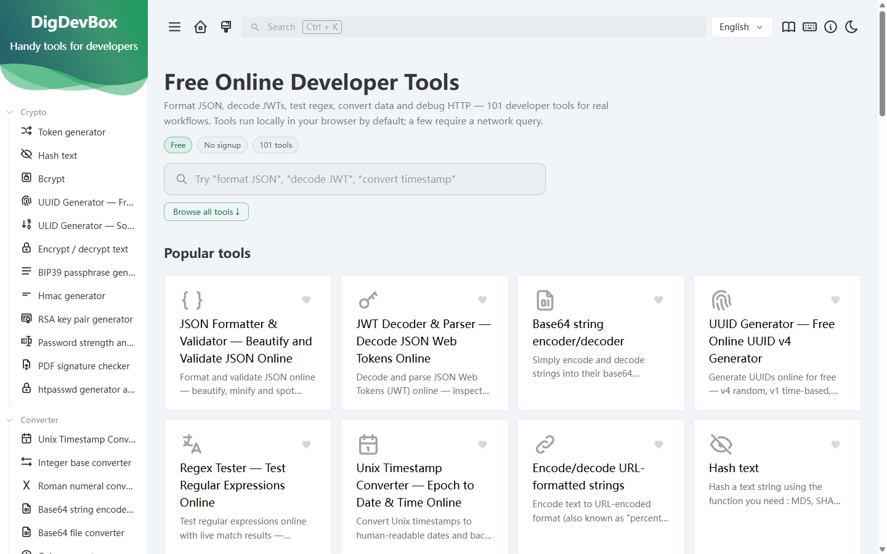
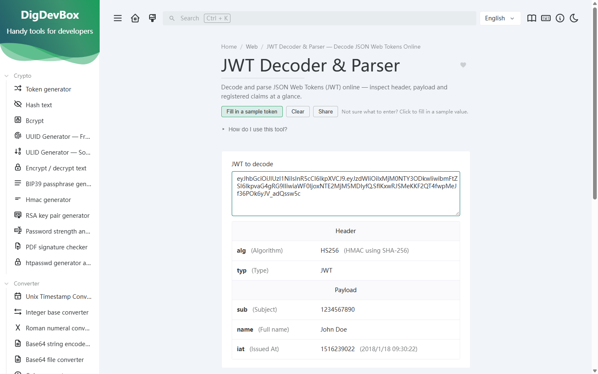
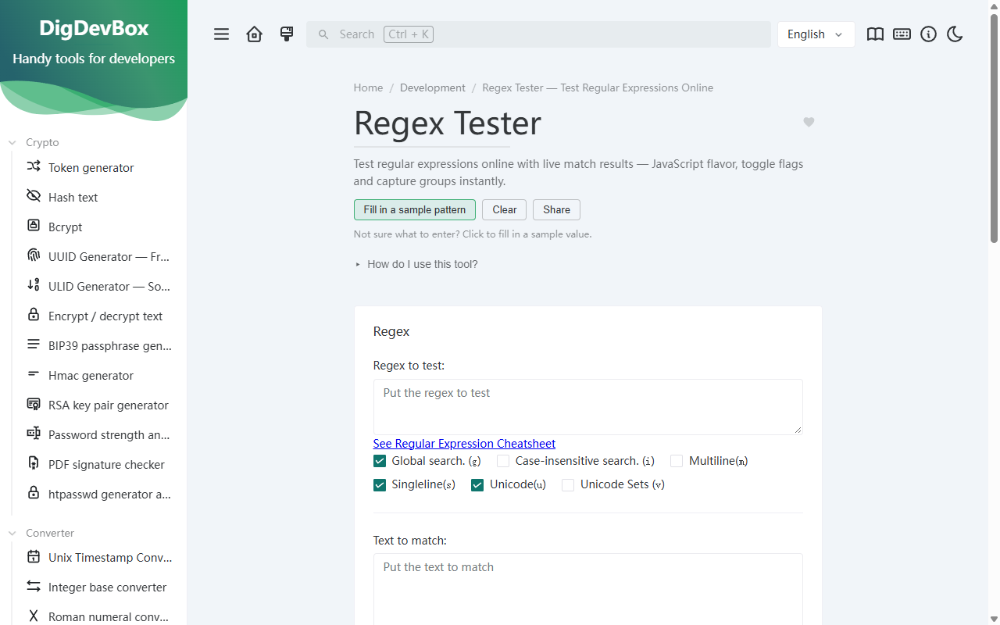

# DigDevBox — Developer Tools

**DigDevBox** is a collection of 121 free online tools for developers and DevOps — JSON, JWT, regex, UUID, network and more. Tools run locally in your browser by default; a few require a network query.

| | |
| --- | --- |
| **Website** | <https://digdevbox.com> |
| **Blog** | <https://notes.digdevbox.com> |
| **Source code** | <https://github.com/yqh-core/dev-tools> |

<p>
  
</p>

## Screenshots

| | | |
| :---: | :---: | :---: |
|  |  |  |
| JWT Decoder & Parser | JSON Formatter & Validator | Regex Tester |

## Why DigDevBox

- **121 utilities across 10 categories** — see the full list below
- **No signup, no installation** — open a page and use the tool
- **Local-first** — most tools process data entirely in your browser; nothing is uploaded (a few tools, e.g. WHOIS lookup and HTTP status checker, query a backend API and are labeled as such)
- **Open source** — GPLv3, self-hostable as a static site

## All tools (121)

<!-- generated-tools-list:start -->
### Crypto

- [Random Token Generator — Custom Length & Character Sets](https://digdevbox.com/token-generator) - Generate random strings 1–512 characters long using uppercase, lowercase, digits and optional symbols. Choose the character sets and copy or refresh the result. Uses non-cryptographic randomness; do not use for passwords, API secrets or security tokens.
- [Hash Generator — MD5, SHA-1, SHA-256 Online](https://digdevbox.com/hash-text) - Hash a text string using the function you need : MD5, SHA1, SHA256, SHA224, SHA512, SHA384, SHA3 or RIPEMD160 — with 16-digit MD5 and upper/lower-case hex output
- [Bcrypt Hash Generator & Checker — Hash and Compare Passwords](https://digdevbox.com/bcrypt) - Generate bcrypt hashes with configurable salt rounds from 0 to 100 and compare a plaintext value against an existing bcrypt hash. The browser-based bcryptjs tool does not decrypt hashes or store account credentials.
- [UUID Generator — v4, v1, v3, v5 and NIL IDs](https://digdevbox.com/uuid-generator) - Generate UUIDs online for free — v4 random, v1 time-based, v3/v5 namespace UUIDs and NIL, with one-click copy.
- [ULID Generator — Time-Ordered, Sortable IDs Online](https://digdevbox.com/ulid-generator) - Generate ULIDs online — sortable, time-ordered unique identifiers, ideal for database keys and distributed systems.
- [Nano ID Generator — Short, URL-safe Unique IDs Online](https://digdevbox.com/nanoid-generator) - Generate nanoid-style unique IDs online — URL-safe alphabet, any length, batch of up to 200, built with crypto randomness in your browser.
- [Encrypt / decrypt text](https://digdevbox.com/encryption) - Encrypt clear text and decrypt ciphertext using crypto algorithms like AES, TripleDES, Rabbit or RC4.
- [BIP39 passphrase generator](https://digdevbox.com/bip39-generator) - Generate a BIP39 passphrase from an existing or random mnemonic, or get the mnemonic from the passphrase.
- [HMAC Generator — Sign Messages with SHA-256 Online](https://digdevbox.com/hmac-generator) - Generate HMAC signatures online with SHA-256/SHA-512 and a secret key — debug webhook signature mismatches, output hex or Base64. Keys stay in your browser.
- [RSA Key Pair Generator — Create Public & Private PEM Keys](https://digdevbox.com/rsa-key-pair-generator) - Generate an RSA public/private key pair in your browser and copy both PEM outputs. Choose a key size from 256 to 16,384 bits in 8-bit steps; no native OpenSSH output or other key algorithms are included.
- [Password Strength Checker — Entropy & Crack-Time Estimate](https://digdevbox.com/password-strength-analyser) - Estimate password length, character-set entropy, score and brute-force crack time locally in your browser. The estimate does not account for dictionary attacks and is not a guarantee; the password is not uploaded.
- [Password Generator](https://digdevbox.com/password-generator) - Generate strong, secure random passwords online — pick the length (8-128) and character sets, with a cryptographic random source. Ambiguous characters (Il1O0) excluded by default, nothing leaves your browser.
- [PDF Signature Checker — Verify PDF Signatures & Certificates](https://digdevbox.com/pdf-signature-checker) - Inspect supported PDF digital signatures, check signed-byte integrity and certificate trust or expiry, and distinguish unsupported or unreadable files. These are technical checks, not legal certification.
- [PDF Merge — Combine PDF Files Online](https://digdevbox.com/pdf-merge) - Combine two or more PDF files into one document in your browser. Files are merged in upload order, with page counts shown before you start; download the combined PDF.
- [PDF Split — Split PDF Pages or Extract a Range](https://digdevbox.com/pdf-split) - Split a PDF into separate single-page files or extract a selected page range into a new PDF. Check the page count first; processing runs in your browser.
- [PDF Watermark — Add Text Watermarks to PDF](https://digdevbox.com/pdf-watermark) - Add a text watermark to every page of a PDF. Adjust font size, opacity and angle, then choose a single centered line or a tiled layout; processing stays in your browser.
- [PDF Compressor — Reduce PDF File Size Online](https://digdevbox.com/pdf-compress) - Compress a PDF by recompressing embedded photos and rebuilding file structure. Compare before-and-after sizes with balanced or strong compression; text and vector content stay untouched, and the result is never larger than the original.
- [htpasswd Generator & Checker — bcrypt & apr1](https://digdevbox.com/htpasswd-generator) - Build multi-user Apache/Nginx .htpasswd files with bcrypt or apr1. Copy, download or verify a username:hash line locally. Passwords stay in your browser.

### Converter

- [Date Converter — Formats, Time Zones and ISO 8601](https://digdevbox.com/date-converter) - Convert between date formats online — ISO 8601, RFC 3339, UTC, locale, Excel, Mongo ObjectID and Unix timestamps.
- [Unix Timestamp Converter — Epoch to Date, Seconds vs Milliseconds](https://digdevbox.com/unix-timestamp-converter) - Convert a Unix epoch timestamp (seconds or milliseconds) to a readable date, or turn a date into a timestamp online.
- [Number Base Converter — Bases 2–64](https://digdevbox.com/base-converter) - Convert non-negative integers between bases 2–64, including binary, octal, decimal, hexadecimal and custom alphabets. This converts numbers, not text.
- [Roman numeral converter](https://digdevbox.com/roman-numeral-converter) - Convert Roman numerals to numbers and convert numbers to Roman numerals.
- [Base64 Encoder & Decoder — Padding, URL-Safe, Binary-Safe](https://digdevbox.com/base64-string-converter) - Encode and decode Base64 online — URL-safe base64url, padding options, binary-safe text, with RFC 4648 and atob()/btoa() notes. Free, in your browser.
- [Base64 to Image — Online Decode, Preview and Download](https://digdevbox.com/base64-file-converter) - Convert a string, file, or image into its base64 representation.
- [Color Converter — HEX, RGB, HSL, HWB, LCH and CMYK](https://digdevbox.com/color-converter) - Convert and edit colors between HEX, RGB, HSL, HWB, LCH, CMYK and the nearest CSS color name, with a color picker. Values are computed in your browser.
- [Color Contrast Checker — Pass or Fail WCAG AA and AAA](https://digdevbox.com/color-contrast-checker) - Check the contrast ratio between two colours against WCAG 2.x AA and AAA thresholds for normal and large text, with a live text preview.
- [Text Case Converter — camelCase, snake_case & More](https://digdevbox.com/case-converter) - Convert text between camelCase, PascalCase, snake_case, kebab-case, CONSTANT_CASE, uppercase, lowercase and other naming styles. Paste once, choose a format and copy the result.
- [Text to NATO alphabet](https://digdevbox.com/text-to-nato-alphabet) - Transform text into the NATO phonetic alphabet for oral transmission.
- [Text to Binary Converter — ASCII 8-Bit Encoder & Decoder](https://digdevbox.com/text-to-binary) - Convert basic ASCII text to 8-bit binary groups and decode byte-aligned ASCII binary back to text. This is not a Unicode or UTF-8 byte encoder.
- [Text to Unicode Converter — Decimal HTML References & Code Points](https://digdevbox.com/text-to-unicode) - Convert text to decimal HTML numeric character references and back, or convert text to decimal Unicode code-point lists. HTML-reference mode uses UTF-16 code units and does not support hexadecimal entities or \u escapes.
- [YAML to JSON Converter — Convert YAML Online](https://digdevbox.com/yaml-to-json-converter) - Convert YAML configuration data into JSON in your browser. Nested mappings become objects, sequences become arrays, and YAML scalar types are reflected in the JSON output; comments are not preserved.
- [YAML to TOML](https://digdevbox.com/yaml-to-toml) - Parse and convert YAML to TOML.
- [JSON to YAML converter](https://digdevbox.com/json-to-yaml-converter) - Simply convert JSON to YAML with this online live converter.
- [JSON to TOML Converter](https://digdevbox.com/json-to-toml) - Convert JSON or JSON5 objects to TOML. Nested objects become tables or dotted keys; arrays become TOML arrays. Unsupported values may prevent conversion.
- [List Converter — Sort, Deduplicate & Format Lines](https://digdevbox.com/list-converter) - Clean up a line-by-line list: remove duplicate lines, sort or reverse items, trim whitespace, change case, add item prefixes or suffixes, and join values with a chosen separator. Runs in your browser.
- [TOML to JSON Converter — Convert TOML Config to JSON](https://digdevbox.com/toml-to-json) - Convert TOML configuration into formatted JSON. Tables and arrays of tables become nested objects and arrays; TOML date and time values are serialized as strings, while comments and formatting are not preserved.
- [TOML to YAML](https://digdevbox.com/toml-to-yaml) - Parse and convert TOML to YAML.
- [XML to JSON Converter — Convert XML Online](https://digdevbox.com/xml-to-json) - Convert XML into JSON in your browser. Elements become objects, repeated elements become arrays, and attributes and text are represented with separate keys.
- [JSON to XML](https://digdevbox.com/json-to-xml) - Convert JSON data to XML format.
- [Markdown to HTML Converter — Live Preview & HTML Output](https://digdevbox.com/markdown-to-html) - Convert Markdown to HTML with a live preview in your browser. Copy the generated HTML or use the print dialog to save the rendered result as a PDF.
- [RMB amount in Chinese uppercase](https://digdevbox.com/rmb-uppercase) - Turn a numeric amount into the Chinese financial uppercase wording (yuan / jiao / fen), with an optional RMB prefix.
- [ASCII table](https://digdevbox.com/ascii-table) - The standard ASCII table from 0 to 127 with decimal, hexadecimal, octal and binary values, searchable by character or code.

### Web

- [URL Encoder & Decoder — Percent-Encoding, encodeURIComponent Pitfalls](https://digdevbox.com/url-encoder) - Encode text to URL-encoded format (also known as "percent-encoded"), or decode from it.
- [HTML Entity Encoder & Decoder](https://digdevbox.com/html-entities) - Encode and decode HTML entities for ampersands, angle brackets, quotes and apostrophes. Search named and numeric references; encoding does not sanitize HTML.
- [URL Parser — Inspect Query Parameters and UTM Tags](https://digdevbox.com/url-parser) - Parse a URL into its scheme, hostname, port, path, query parameters and fragment. Inspect UTM tags in the URL with your browser's built-in parser.
- [Device information](https://digdevbox.com/device-information) - Get information about your current device (screen size, pixel-ratio, user agent, ...)
- [Basic Auth Generator & Decoder — HTTP Header](https://digdevbox.com/basic-auth-generator) - Generate or decode an HTTP Basic Authorization header in your browser. Copy the Base64 token for cURL; Base64 is not encryption, so use HTTPS.
- [Open Graph & Twitter Meta Tag Generator — Create Social Share Tags](https://digdevbox.com/og-meta-generator) - Generate copyable Open Graph and Twitter Card HTML meta tags for a page title, description, URL and social image. Choose website, article, book, profile, music or video metadata; no live share-card preview is included.
- [TOTP Code Generator — 6-Digit Codes & QR](https://digdevbox.com/otp-generator) - Generate current, previous and next 6-digit TOTP codes from a Base32 secret, view the 30-second timer, and create an otpauth QR code. Uses Web Crypto.
- [MIME Type Lookup — Content-Type, Extensions & Server Config](https://digdevbox.com/mime-types) - Look up MIME types by extension or find extensions by Content-Type. Generate copy-ready Nginx types, Apache AddType and static _headers rules from the selected mapping.
- [JWT Decoder & Parser — Inspect Header, Payload and Expiration](https://digdevbox.com/jwt-parser) - Decode JWTs online — inspect header, payload, claims and expiration (exp/iat) as readable dates. Your token never leaves your browser. Free, no signup.
- [Keycode info](https://digdevbox.com/keycode-info) - Find the javascript keycode, code, location and modifiers of any pressed key.
- [URL Slug Generator — Create SEO-Friendly Slugs in Bulk](https://digdevbox.com/slugify-string) - Generate URL slugs from titles in bulk. Choose hyphens, underscores or dots, remove English stop words, set a word-safe length cap and preview full URLs.
- [Bulk 301 Redirect Generator — Apache, Nginx & Cloudflare](https://digdevbox.com/redirect-generator) - Generate bulk redirects for Apache, Nginx, Cloudflare, Netlify and Vercel. Import CSV, detect loops and chains, and export server-ready rules locally.
- [HTML WYSIWYG Editor — Format Text & Copy HTML](https://digdevbox.com/html-wysiwyg-editor) - Format text visually with headings, paragraphs, lists, quotes, inline formatting and code blocks, then copy the generated HTML. Tables, images, links and direct source editing are not supported.
- [User Agent Parser — Browser, OS & Device Detection](https://digdevbox.com/user-agent-parser) - Parse a user-agent string to identify its browser, rendering engine, operating system, CPU and device type. Use the results for debugging and analytics, not authentication.
- [HTTP status codes](https://digdevbox.com/http-status-codes) - The list of all HTTP status codes, their name, and their meaning.
- [JSON Diff Checker — Compare JSON Online](https://digdevbox.com/json-diff) - Compare JSON files or pasted JSON online. Inspect nested changes by path, export a report, and match arrays by index, ignore-order or stable ID. Large comparisons run in a cancellable worker.
- [Outlook Safe Links Batch Decoder — Reveal Original URLs](https://digdevbox.com/safelink-decoder) - Batch-decode Microsoft Outlook Safe Links one wrapper per line. Unwrap up to five layers, inspect destination scheme and host, and copy valid URLs; local parsing only, no safety scan.
- [JSON to Query String Converter](https://digdevbox.com/json-to-get-params) - Percent-encode nested JSON as URL query parameters, or rebuild JSON from a query string or full URL. Supports bracketed object keys and indexed arrays.
- [HTTP Header Analyzer — HAR Import & Security Score](https://digdevbox.com/http-headers) - Import HAR or paste curl/DevTools headers. Check CSP, HSTS, cookies, CORS and indexing; get a score plus copy-ready Nginx, Vercel and Cloudflare fixes locally.

### Images and videos

- [QR Code Generator — Create & Download Custom QR Codes](https://digdevbox.com/qrcode-generator) - Create a QR code from a URL or text. Customize foreground and background colors, choose an error-correction level, and download a PNG image.
- [WiFi QR Code Generator — Create Network Login QR Codes](https://digdevbox.com/wifi-qrcode-generator) - Generate a WiFi QR code for WPA/WEP, open networks or WPA2-EAP. Enter SSID, password, hidden-network and EAP settings, customize colors and download a PNG. QR codes contain credentials in readable form.
- [SVG placeholder generator](https://digdevbox.com/svg-placeholder-generator) - Generate svg images to use as a placeholder in your applications.
- [Webcam Recorder — Record Video & Take Photos Online](https://digdevbox.com/camera-recorder) - Record webcam video or take still photos in your browser. Choose a camera and microphone, pause or resume recording, then download your clip. Files stay on your device.
- [Image Resizer — Resize Images to Exact Dimensions](https://digdevbox.com/image-resize) - Resize an image to exact pixel width and height, with an optional aspect-ratio lock. Export PNG, JPEG or WebP when your browser supports the format; processing happens locally.
- [Image Compressor — Reduce JPEG & WebP File Size](https://digdevbox.com/image-compress) - Compress JPEG and WebP images in your browser. Adjust output quality or set a target file size in KB; compression is lossy, and the target may be unreachable for some images.
- [Image Cropper — Crop Photos to Any Aspect Ratio](https://digdevbox.com/image-crop) - Crop an image to an exact pixel region online. Choose a preset aspect ratio or freeform selection, then export at the selected dimensions in a supported image format.
- [Image Color Picker — Get HEX, RGB & HSL from Any Image](https://digdevbox.com/image-color-picker) - Pick a pixel in an image to read its stored HEX, RGB and HSL values. Sampling uses the original image bitmap locally in your browser; transparent pixels report stored RGB values without alpha compositing.
- [Favicon Generator — Create ICO & PNG Icons](https://digdevbox.com/favicon-generator) - Create a multi-size favicon.ico, Apple touch icon and PNG app icons from an image. Choose a transparent or white background; image processing runs in your browser.
- [Images to PDF Converter — Combine JPG & PNG Online](https://digdevbox.com/image-to-pdf) - Combine multiple images into one PDF, with each image placed on its own page. Add images, review the selection and create a downloadable PDF in your browser.

### Development

- [Git Commands Cheat Sheet — Common Commands & Undo](https://digdevbox.com/git-memo) - Quick reference for Git configuration, init/clone, commits, amend, reset and branch rename commands, with copyable examples. Replace placeholders before running; hard reset can discard work.
- [Random port generator](https://digdevbox.com/random-port-generator) - Generate random port numbers outside of the range of "known" ports (0-1023).
- [Crontab Generator — Cron Expressions with Plain-English Preview](https://digdevbox.com/crontab-generator) - Build cron expressions with a plain-English preview — every 5 minutes, weekdays, @reboot. Validate crontab and GitHub Actions schedules free in your browser.
- [JSON Formatter — Format, Validate & Diff](https://digdevbox.com/json-prettify) - Format and validate JSON online — pretty-print at your indent size, sort keys and spot syntax errors instantly, right in your browser.
- [JSON Workspace — JSONPath, Tree & Schema](https://digdevbox.com/json-workspace) - Format and validate JSON, inspect an interactive tree, query with JSONPath, infer JSON Schema, and convert to YAML or CSV. Free in your browser.
- [REST API Tester — cURL, Tests & Collections](https://digdevbox.com/api-debugger) - Send REST API requests, import cURL, inspect status, headers and JSON, add assertions, and run saved collections. Requests pass through a temporary relay.
- [JSON minify](https://digdevbox.com/json-minify) - Minify and compress your JSON by removing unnecessary whitespace.
- [JSON to CSV](https://digdevbox.com/json-to-csv) - Convert JSON to CSV with automatic header detection.
- [CSV to JSON Converter — Preview Rows & Convert Online](https://digdevbox.com/csv-to-json) - Paste CSV, choose whether the first row contains column names, preview parsed rows and copy or download the resulting JSON. Handles quoted fields and reports parse warnings.
- [SQL Formatter — Format and Beautify SQL Online](https://digdevbox.com/sql-prettify) - Paste a messy SQL query and get it formatted — or minified to one line. Keywords upper-cased, clauses indented, one field per line. Supports PostgreSQL, MySQL, T-SQL, BigQuery and 8 more dialects, free in your browser.
- [Chmod Calculator — Unix File Permissions (755, 644, 777)](https://digdevbox.com/chmod-calculator) - Compute your chmod permissions and commands with this online chmod calculator.
- [Docker Run to Compose Converter](https://digdevbox.com/docker-run-to-docker-compose-converter) - Paste a docker run command and get a docker-compose service — ports, volumes and env mapped. Free online decomposerize alternative, in your browser.
- [XML Formatter — Beautify, Validate and Minify XML](https://digdevbox.com/xml-formatter) - Prettify or minify your XML string — human-readable indentation, or strip it back down to a single line.
- [YAML Formatter & Validator — Format YAML Online](https://digdevbox.com/yaml-prettify) - Format and validate YAML online — fix indentation, catch tabs and syntax errors before kubectl or CI rejects your config. Free, runs in your browser.
- [Email Address Normalizer](https://digdevbox.com/email-normalizer) - Normalize email addresses to a standard format for easier comparison, deduplication and data cleaning.
- [Regular Expression Tester — JavaScript Regex](https://digdevbox.com/regex-tester) - Test JavaScript regular expressions online with live matches, capture groups, replacement preview and named positive/negative test cases with pass/fail results. A 300ms worker timeout stops runaway patterns.
- [Regex Cheat Sheet — Complete Regular Expression Reference](https://digdevbox.com/regex-memo) - A complete regex cheat sheet — common regular expression syntax, quantifiers, flags and character classes with examples.
- [PX to REM Converter — Batch Conversion with Root Font Size](https://digdevbox.com/px-rem-converter) - Convert batches of CSS pixel and rem values in either direction. Set the root font size and decimal precision; values can be separated by spaces, commas or newlines.
- [JSON to model classes](https://digdevbox.com/json-to-code) - Generate TypeScript, C#, Java or Go model classes from JSON, splitting nested objects into their own classes.
- [Linux commands cheat sheet](https://digdevbox.com/linux-commands) - A searchable cheat sheet of common Linux commands with what they do and ready-to-use examples.
- [Prepare Deployment — Pre-Deploy Readiness Gate for Docker, CI & Lockfiles](https://digdevbox.com/prepare-deployment) - Pre-deployment readiness gate for your project. Paste package.json, lockfile, Dockerfile and CI workflow, or import Trivy/Checkov/Hadolint/SARIF JSON or actionlint text; get a READY / READY_WITH_WARNINGS / BLOCKED / NOT_ASSESSED verdict with evidence-backed findings (reproducible builds, pinned images, non-root containers, CI injection risks, hardcoded secrets, real scanner results) and an exportable release report. Inspired by Vercel/Netlify preflight checks; runs fully in your browser.

### Network

- [IPv4 Subnet Calculator — CIDR, Netmask & Usable Hosts](https://digdevbox.com/ipv4-subnet-calculator) - Calculate an IPv4 subnet from an address and CIDR prefix. See the network and broadcast addresses, netmask, wildcard mask, subnet size and first/last host addresses.
- [IPv4 address converter](https://digdevbox.com/ipv4-address-converter) - Convert an IP address into decimal, binary, hexadecimal, or even an IPv6 representation of it.
- [IP Range to CIDR Converter — Convert IPv4 Ranges Online](https://digdevbox.com/ipv4-range-expander) - Convert a start and end IPv4 address into the smallest set of CIDR blocks that covers the full range. Useful for firewall rules, cloud security groups and routing tables.
- [MAC address lookup](https://digdevbox.com/mac-address-lookup) - Find the vendor and manufacturer of a device by its MAC address.
- [MAC address generator](https://digdevbox.com/mac-address-generator) - Enter the quantity and prefix. MAC addresses will be generated in your chosen case (uppercase or lowercase)
- [IPv6 ULA generator](https://digdevbox.com/ipv6-ula-generator) - Generate RFC 4193 fd00::/8 IPv6 Unique Local Address (ULA) /48 prefixes with secure random 40-bit Global IDs or a manual Global ID. Create up to 20 prefixes and inspect first/last /64 subnets in your browser.
- [Domain WHOIS & RDAP Lookup — Check Registration Details](https://digdevbox.com/whois-lookup) - Look up domain registration data through RDAP, including registrar, registration and expiry dates, status and nameservers when supplied by the registry. Coverage and returned fields vary by domain extension.
- [HTTP status checker](https://digdevbox.com/http-status-checker) - Check the live HTTP status code and response headers of a URL to troubleshoot reachability, redirects and caching.
- [Today in history](https://digdevbox.com/today-in-history) - See what happened on this day in history. Events load automatically when the page opens.

### Math

- [Math evaluator](https://digdevbox.com/math-evaluator) - A calculator for evaluating mathematical expressions. You can use functions like sqrt, cos, sin, abs, etc.
- [ETA Calculator — Task Completion Time](https://digdevbox.com/eta-calculator) - Estimate time remaining for a download, build or batch job. Enter a known processing rate or derive throughput from completed work and elapsed time.
- [Percentage Calculator — Percent of, Change & Difference](https://digdevbox.com/percentage-calculator) - Calculate percentages, discounts, percentage change, reverse percentages and percentage points. Seven modes plus batch CSV/TSV export and worked formulas.

### Measurement

- [Chronometer](https://digdevbox.com/chronometer) - Monitor the duration of a thing. Basically a chronometer with simple chronometer features.
- [Temperature Converter — Celsius, Fahrenheit, Kelvin & More](https://digdevbox.com/temperature-converter) - Convert between Celsius, Fahrenheit, Kelvin, Rankine, Delisle, Newton, Réaumur and Rømer. Enter a value in any scale to update the other seven instantly.
- [Unit converter](https://digdevbox.com/unit-converter) - Convert between 11 categories of units: length, area, volume, weight, speed, time, data storage, power, pressure, angle and temperature.
- [Benchmark builder](https://digdevbox.com/benchmark-builder) - Easily compare execution time of tasks with this very simple online benchmark builder.
- [Reaction Time Test](https://digdevbox.com/reaction-time-test) - Measure your visual reaction time in the browser — wait for the panel to turn green and click the instant it does, with best, median and mean over five rounds.

### Text

- [Lorem Ipsum Generator](https://digdevbox.com/lorem-ipsum-generator) - Generate lorem ipsum placeholder text — paragraphs, sentences or words — for layouts and mockups. The classic printing-industry dummy text since the 1500s, free and instant, right in your browser.
- [Text Statistics — Word & Character Counter](https://digdevbox.com/text-statistics) - Count words, characters, Unicode units, lines and UTF-8 bytes. Analyze top-term frequency and estimate reading and speaking time in your browser, with no text upload.
- [Emoji picker](https://digdevbox.com/emoji-picker) - Copy and paste emojis easily and get the unicode and code points value of each emoji.
- [String obfuscator](https://digdevbox.com/string-obfuscator) - Obfuscate a string (like a secret, an IBAN, or a token) to make it shareable and identifiable without revealing its content.
- [Text Diff Checker — Compare Two Texts Side by Side](https://digdevbox.com/text-diff) - Compare two text inputs in a side-by-side diff editor to spot additions, deletions and changed lines.
- [Numeronym Generator — i18n, a11y & k8s](https://digdevbox.com/numeronym-generator) - Generate numeronyms from pasted words and phrases. Supports Unicode letters, hyphenated terms, case-preserving batch output and lookups for i18n, a11y and k8s.
- [ASCII Art Generator](https://digdevbox.com/ascii-text-drawer) - Turn text into ASCII art with multiple fonts and styles.
- [Full-width / half-width converter](https://digdevbox.com/fullwidth-converter) - Convert between full-width and half-width characters using the fixed Unicode offset 0xFEE0, or adjust punctuation only.
- [Morse Code Translator — Encode Text & Decode Morse](https://digdevbox.com/morse-code-converter) - Translate text to Morse code or decode dot-and-dash sequences. Supports A–Z, digits and common punctuation; letters are separated by spaces and words by slashes.
- [Find and Replace Text — Plain Text & Regex Replacer](https://digdevbox.com/text-replacer) - Paste text, find a phrase or regular expression, replace or remove matches, ignore case and see the replacement count and output length.

### Data

- [International Phone Number Parser & Formatter — E.164](https://digdevbox.com/phone-parser-and-formatter) - Parse and validate an international phone number, then copy E.164, national, international or RFC 3966 formats. Batch-check up to 200 numbers locally and export CSV.
- [IBAN Validator & Parser — Check Format, Country & BBAN](https://digdevbox.com/iban-validator-and-parser) - Validate an IBAN's country-specific structure and checksum, inspect errors, identify QR-IBAN status and extract the country code and BBAN. A valid checksum does not confirm account ownership or payment availability.
<!-- generated-tools-list:end -->

## Differences from upstream [it-tools](https://github.com/CorentinTh/it-tools)

This project is built on top of [it-tools](https://github.com/CorentinTh/it-tools) (GPL-3.0) and stays GPL-3.0. Compared with upstream:

- Rebranded as **DigDevBox** (sidebar, command palette, about page, SEO metadata)
- Attribution preserved: the about page states the upstream origin and license
- Added tools for Chinese-language scenarios and DevOps workflows (RMB uppercase, fullwidth converter, px↔rem, Morse code, WHOIS lookup, HTTP status checker, htpasswd, Linux commands cheat sheet, ASCII table, and more)
- SEO infrastructure: static pre-rendering for all tool pages, sitemap, per-tool landing content, multilingual keywords
- Removed upstream sponsorship links and external social accounts

## Development

```sh
npm install pnpm -g    # once
pnpm install
pnpm dev               # dev server
pnpm build             # production build (pre-rendered + sitemap)
```

### Deploy (nginx)

```nginx
server {
    listen 80;
    server_name localhost;
    root /usr/share/nginx/html;
    index index.html;

    location / {
        try_files $uri $uri/ /index.html;
    }
}
```

> 运行环境需要 Node.js（<https://nodejs.org/zh-cn/download>）。
> 浏览器调试时可临时关闭 Service Worker：DevTools → Application → Service Workers → Unregister。

## License

GPL-3.0. Upstream [it-tools](https://github.com/CorentinTh/it-tools) by Corentin Th — thank you.
